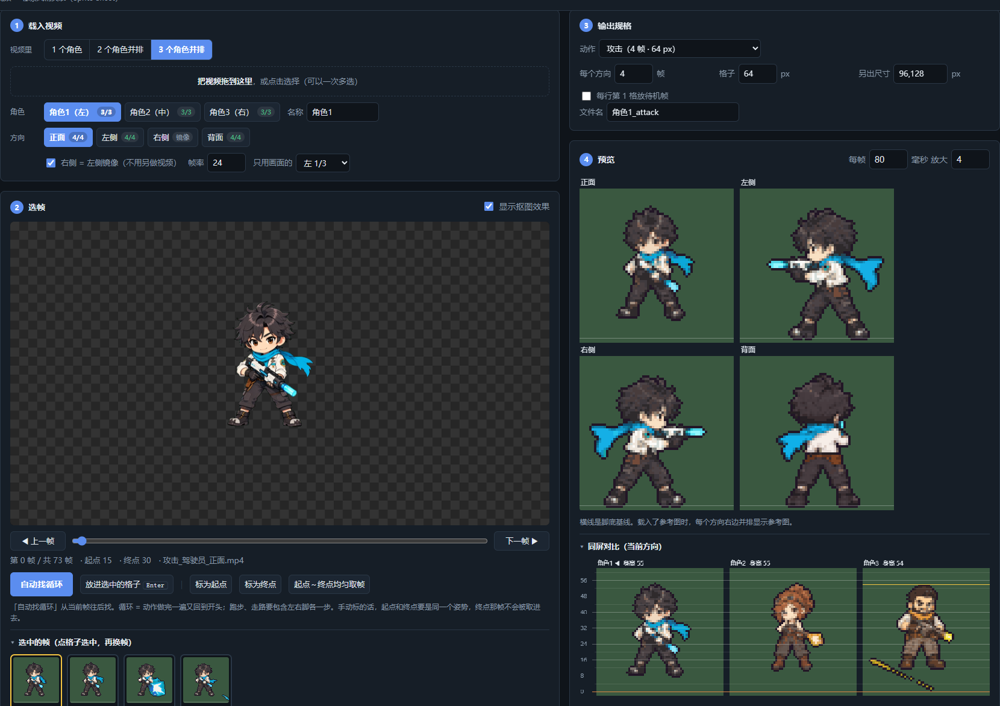
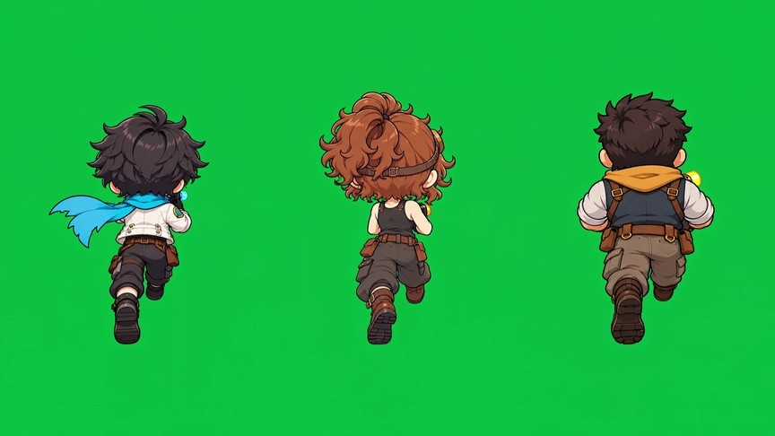
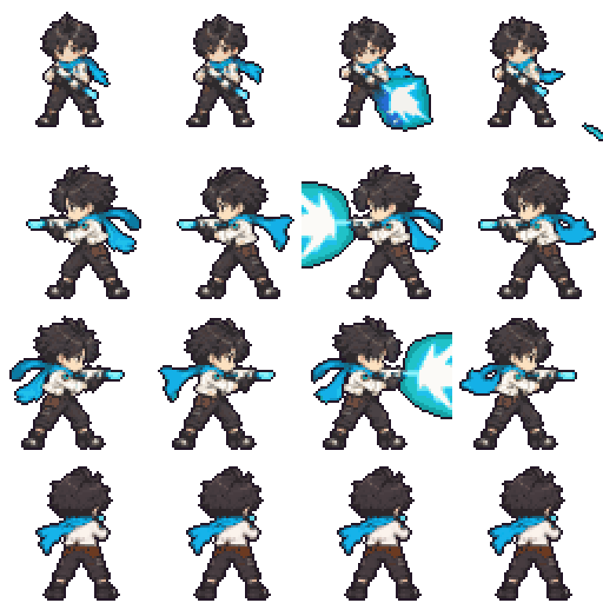
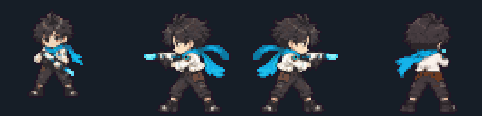

# 视频抽帧工具 · Video Sprite Extractor

**把绿幕角色动作视频，变成游戏能用的像素精灵表（Sprite Sheet）。**
单个网页文件，双击就能用；全部在本机浏览器里处理，不联网、不上传。

**在线使用**：https://fzlaoyuan.github.io/video-sprite-extractor/ （打开就能用，视频只在你自己的浏览器里处理，不会上传）

[English below](#english)



| 输入：绿幕动作视频 | 输出：四方向精灵表 |
|---|---|
|  |  |



这是我（老白）做像素游戏《星萌EV》时，用 AI 写的小工具。游戏里的角色动画就是用它从 AI 生成的动作视频里抽出来的。好用，就分享出来。

## 能做什么
- **一条视频最多 3 个角色**：并排放在一个绿幕视频里，分别选帧、分别导出。
- **自动找循环**：在首尾最接得上的位置均匀取帧。跑步、走路选「两步」，其它动作选「一步」。不满意的格子可以逐帧换。
- **抠图、身高、颜色**：抠图强度、身高占格子、脚底位置、压色、描边、亮度、对比、饱和，边调边看实时预览。
- **同屏对比 + 标尺**：多个角色并排比身高，调到一致。
- **参考图**：载入已有的精灵表，自动校色、量身高。
- **导出**：每行一个方向（正面 / 左侧 / 右侧 / 背面），右侧可以直接由左侧镜像，另外可以多出几个放大尺寸，还有一份能读回来接着改的「选帧记录.json」。
- 预设：跑步、走路、待机、攻击、大型攻击、场景物件单行循环、黑底发光特效。

## 怎么用
1. 下载本仓库（右上角 **Code → Download ZIP**），解压。
2. 用 **Chrome 或 Edge** 打开 `视频抽帧工具.html`。
3. 拖进视频 → 自动找循环 → 调整 → 导出 PNG。

详细步骤和常见问题见 [使用说明.txt](使用说明.txt)。

**视频建议**：角色站在纯绿背景上原地做动作，镜头固定；MP4（H.264），3～5 秒就够。文件名带「正面 / 侧面 / 背面」「跑 / 走 / 待机 / 攻击」会自动分方向、选规格。

## 附带：场景动画抽帧（Python）
`场景动画抽帧.py` 用来处理场景物件（发光植物、地标、建筑）的循环小动画：
- 一个视频里可以放 1 个或 2×2 四个物件，各出一张精灵表和预览 GIF；
- 自动识别背景色，去掉发光和背景混出来的光晕；
- 动态太小的物件只出静态图。

需要 Python 3.9+：
```
pip install opencv-python numpy pillow
python 场景动画抽帧.py 视频.mp4 --grid 2 --n 12 --size 128
```
Windows 上也可以直接把视频拖到 `场景动画抽帧（拖视频到这里）.bat` 上。

## 许可
- 代码（`.html`、`.py`、`.bat`）：[MIT](LICENSE)，随便用、随便改，商用也可以。
- `docs/` 里的图片是《星萌EV》的游戏美术，只作演示，**不在 MIT 许可范围内**，请不要拿去用在别的作品里。

作者：老白（抖音「老白玩AI」）· 网站 [laobaiai.com](https://laobaiai.com/)

---

## English

**Turn green-screen character animation videos into pixel-art sprite sheets for your game.**
It is a single HTML file: open it and it works. Everything runs locally in your browser. Nothing is uploaded.

**Try it online**: https://fzlaoyuan.github.io/video-sprite-extractor/ (videos are processed in your own browser and never uploaded)

I built this with AI while making my pixel game *Xingmeng EV*. The game's character animations were extracted with it from AI-generated motion videos.

### Features
- **Up to 3 characters in one video**, side by side; pick frames and export each one separately.
- **Auto loop finder**: picks evenly spaced frames where the end joins the start best ("two steps" for run and walk, "one step" for other actions). You can replace any frame by hand.
- **Keying, height and color**: key strength, height in cell, foot line, palette reduction, outline, brightness, contrast and saturation, all with a live preview.
- **Side-by-side comparison with a ruler**, to match character heights.
- **Reference sheet**: load an existing sprite sheet to auto-match colors and measure height.
- **Export**: one row per direction (front / left / right / back), with the right row optionally mirrored from the left. Extra sizes can be exported, plus a JSON frame-pick record you can reload later.
- Presets for run, walk, idle, attack, large attack, single-row prop loop, and glowing FX on black.

### Usage
1. Download this repo (**Code → Download ZIP**) and unzip it.
2. Open `视频抽帧工具.html` in **Chrome or Edge**.
3. Drop in a video, then Auto loop → adjust → Export PNG.

The UI is in Chinese. Step-by-step notes are in [使用说明.txt](使用说明.txt).

### Bonus: scene animation extractor (Python)
`场景动画抽帧.py` handles looping scene props: one prop or a 2×2 grid per video. It outputs a sprite strip and a preview GIF for each prop. It detects the background color automatically and removes the glow fringe.
```
pip install opencv-python numpy pillow
python 场景动画抽帧.py video.mp4 --grid 2 --n 12 --size 128
```

### License
- Code: [MIT](LICENSE).
- The images in `docs/` are game art from *Xingmeng EV*, included for demonstration only. They are **not** covered by the MIT license.
